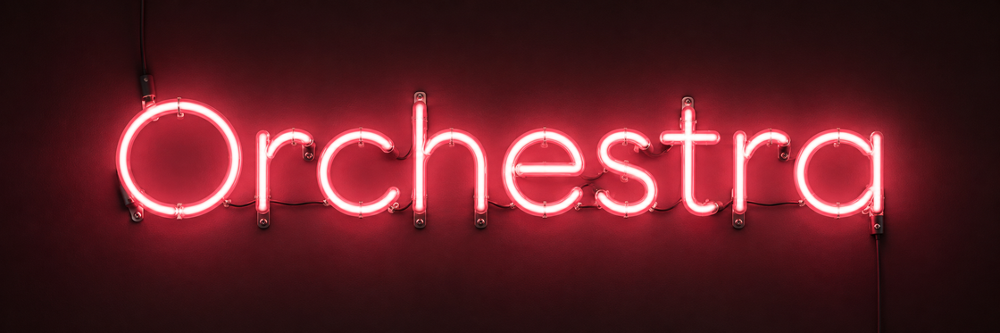
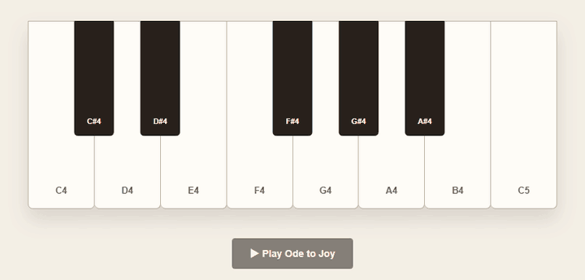
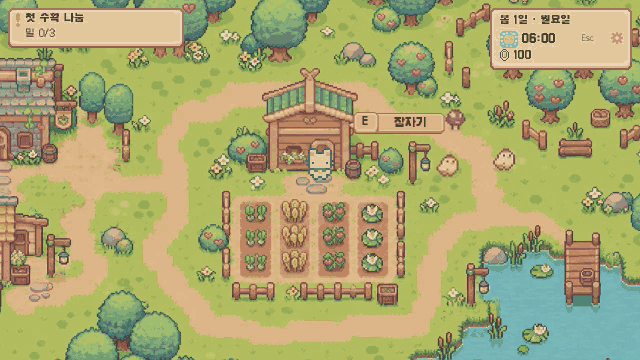

<p align="center">
  
</p>

<p align="center"><a href="README.md">한국어</a> · <b>English</b></p>

<p align="center"><a href="https://github.com/lsy041015/orchestra/actions/workflows/tests.yml"></a></p>

# Orchestra

A Claude Code plugin where the main session plans and reviews, and each piece of implementation goes to a worker that fits its difficulty.

I pay for both Claude and ChatGPT (Codex), and one quota kept running out while the other sat unused. Meanwhile the most expensive model was busy tidying constants.
Handing work to subagents didn't feel great either, since I'd end up trusting a one-line "done".
So I wrote a set of rules and a couple of small scripts: judgment stays in one place, and only the implementation gets handed out.

It's a personal fork of [Superpowers](https://github.com/obra/superpowers) 6.4.1 by Jesse Vincent.
Not an official OpenAI, Anthropic or Superpowers release. Names like Claude and Codex only say which tools it works with; the marks belong to their owners.

## How it works

- The main session writes a plan and shows a table that tags each task Easy / Medium / Hard / Hard (UI). Few-line edits skip the table and just get done.
- One worker per task. By default that's a Claude subagent (`sonnet`); a Codex CLI worker is used only when you mention Codex.
- Workers only touch their allowed files and never start other agents. Codex workers can't even commit, because the sandbox keeps `.git` read-only; the main session commits after review.
- A worker saying `DONE` isn't proof. The main session reads the real diff and test output, and `scope-check.mjs` mechanically checks for files changed outside the allowed list.
- Review findings go back to the same worker (`--resume <thread>` for Codex). If a fix fails twice for the same reason, it stops and the main session re-plans or fixes it itself.
- A ledger at `.orchestra/sdd/<plan>/progress.md` keeps track, so work survives the conversation being compacted.

Workers show up in the task list with engine, model and effort, like `[Codex gpt-6-luna/high] Task 3: retry helper`.
Stop one with `TaskStop`, or say "switch Task 3 to claude opus".

## What it has actually done

<p align="center"></p>

A one-octave web piano ([`examples/piano/`](examples/piano/)), split into three tasks for three Codex workers. Two ran in parallel, 13 min 28 s of worker time.
Every worker said `DONE`, and the main-session review still found five issues: a plan gap, a wrong verification command, doubled key borders, a console error, and invisible repeated notes.
Each task took one fix round. Details are in the [run record](docs/demo/piano/README.md) (Korean).

I also rebuilt the same plan with Claude workers only ([comparison](docs/demo/piano/comparison.md), Korean). Similar time (12 min 26 s vs 13 min 28 s), and the Claude run needed one fewer fix round.
The Codex run used no Claude quota for workers and under 1% of the 7-day Codex quota, but that's one run each, not a general saving.
A [third run on Linux](docs/demo/piano/linux-run/README.md) (Korean) finished in 7 min 2 s with no fix round, yet an independent check found the two issues the first two runs had fixed.

Something bigger: a cozy farming game (Godot 4, about 54k lines of GDScript, 182 commits, 67 headless tests) built in five days this way, first with its predecessor relay and later with Orchestra 0.4.x.
In the last three feature bundles, 22 delegated units were merged and the full suite passed at every merge.

<table>
  <tr>
    <td></td>
    <td></td>
  </tr>
  <tr>
    <td align="center"><sub>Morning on the farm: plant, water, harvest.</sub></td>
    <td align="center"><sub>One review loop: first lookdev (top row), then after five fixes (bottom row).</sub></td>
  </tr>
</table>

The right image is what came back after five fixes went to the same worker.
It's one project, not a controlled comparison, and it doesn't show how much main-session usage was saved. The independent review and the gaps it found are in [issue #19](https://github.com/lsy041015/orchestra/issues/19#issuecomment-5930129097).
Art: Cup Nooble, Sprout Lands (free pack, non-commercial use). The images live on the `showcase` branch, so they aren't in the plugin package.

## Install

You need Claude Code, Git + Bash (Git Bash on Windows) and Node.js 18+. Python 3 for the tests, and a logged-in Codex CLI (`codex --version`, `codex login status`) if you want Codex workers.

```bash
claude plugin marketplace add lsy041015/orchestra
claude plugin install orchestra@orchestra
```

Start a new session afterwards. To update:

```bash
claude plugin marketplace update orchestra
claude plugin update orchestra@orchestra
```

Codex can be the host too, but only for the shared skills; `orchestrator` is Claude Code only.

```bash
codex plugin marketplace add lsy041015/orchestra
codex plugin add orchestra@orchestra
```

Don't enable the original Superpowers or the earlier `relay` plugin at the same time, since the skill names collide.
In PowerShell a bare `bash` may hit the WSL launcher, so run scripts there as `& 'C:\Program Files\Git\bin\bash.exe' <script>`.

Start with `orchestra:using-orchestra`, or just say something like "add retry logic to the login API, use the orchestrator".

## Picking models

Your defaults go in `~/.claude/orchestra.json`, and `<project>/.orchestra.json` overrides them per project. With neither file, it runs on these Claude-only defaults:

```json
{
  "routing": {
    "easy":   "claude sonnet/medium",
    "medium": "claude sonnet/high",
    "hard":   "claude sonnet/xhigh",
    "ui":     "claude sonnet/xhigh"
  },
  "options": ["claude sonnet/high", "claude sonnet/xhigh", "claude opus/high",
              "codex gpt-6-luna/medium", "codex gpt-6-luna/high"]
}
```

Values are `<codex|claude> <model>/<effort>`. If any value comes from a project file, it asks once before the first dispatch, because a cloned repo's config spends your quota.

## What's still rough

- In the end these are rules the host model follows, so nothing technically stops it from breaking them. The scope check around a Claude worker only runs when the main session calls `scope-check.mjs`.
- Parallel workers in the same checkout see each other's changes in the scope check. Give each worker its own worktree if you need them fully apart.
- Tests run in CI on Ubuntu, macOS and Windows, but there's no recorded real use on macOS yet, and I haven't properly measured how much usage it saves.

It's experimental, v0.4.11 ([changelog](CHANGELOG.md)). Next I'd like a cross-platform status line script and per-task usage in the ledger.

## Development

```bash
python3 tests/test_codex_worker.py
python3 tests/test_scope_check.py
python3 tests/test_task_brief.py
python3 tests/test_sdd_safety.py
python3 tests/test_worktree_cleanup.py
python3 tests/test_worktree_instructions.py
python3 tests/test_brainstorm_companion.py
python3 tests/test_skill_text.py
python3 tests/test_release_manifests.py
python3 tests/test_find_polluter.py
(cd examples/piano && node --test)
claude plugin validate --strict .
```

Bugs and ideas go to [Issues](https://github.com/lsy041015/orchestra/issues). Reports from real use on macOS or Linux are especially welcome.

The original copyright and [MIT License](LICENSE) are kept, and the upstream README is in [UPSTREAM_README.md](UPSTREAM_README.md). The banner melody is Beethoven's *Ode to Joy* (public domain).

<p align="center"><sub>LSY.KOR · <a href="https://github.com/lsy041015">More projects</a></sub></p>
