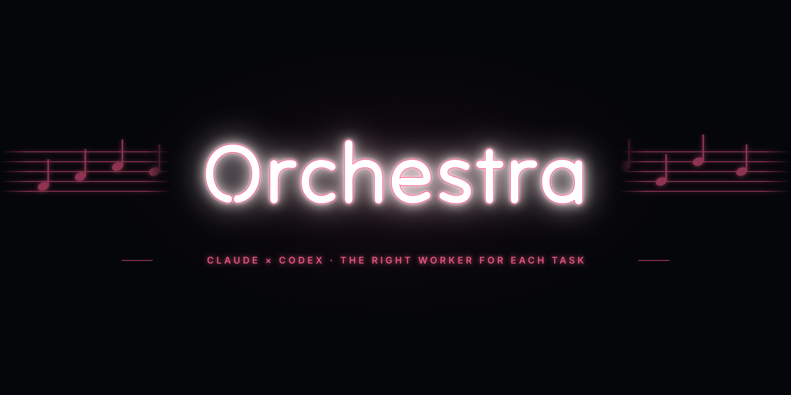
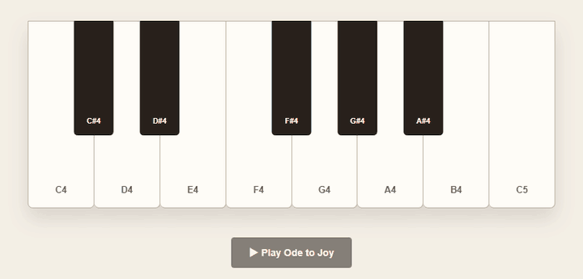
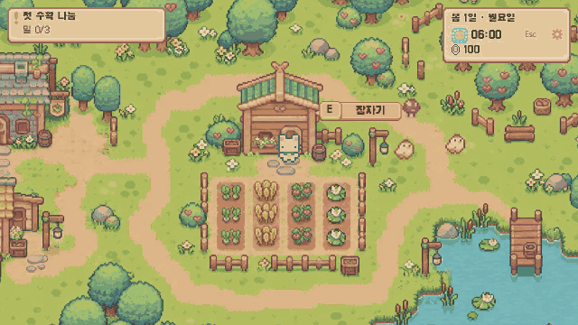

<p align="center">
  
</p>

<p align="center"><b>한국어</b> · <a href="README.en.md">English</a></p>

<p align="center"><a href="https://github.com/lsy041015/orchestra/actions/workflows/tests.yml"></a></p>

# 오케스트라 (Orchestra)

계획과 리뷰는 Claude Code 메인 세션이 하고, 구현은 난이도에 맞는 워커에게 넘기는 플러그인이에요.

Claude랑 ChatGPT(Codex)를 같이 구독하는데, 쓰다 보면 한쪽 한도만 먼저 바닥나고 비싼 모델이 상수 정리 같은 단순 작업까지 하고 있더라고요.
서브에이전트한테 맡기면 "완료했습니다" 한 줄만 믿고 넘어가게 되는 것도 불안했고요.
그래서 판단은 한 곳에 두고, 구현만 알맞은 모델에게 나눠 주는 규칙과 작은 스크립트를 만들었어요.

[Jesse Vincent의 Superpowers](https://github.com/obra/superpowers) 6.4.1을 기반으로 한 개인 포크예요.
공식 OpenAI·Anthropic·Superpowers 배포판이 아니고, Claude·Codex 같은 이름은 연동 대상을 가리킬 때만 써요. 각 상표는 해당 소유자의 것이에요.

## 어떻게 돌아가나

- 메인 세션이 계획을 쓰고, 작업마다 Easy / Medium / Hard / Hard(UI) 티어를 붙인 표를 보여줘요. 몇 줄짜리 수정은 표에 안 올리고 바로 고쳐요.
- 작업 하나에 워커 하나예요. 기본은 Claude 서브에이전트(`sonnet`)고, 사용자가 Codex를 언급했을 때만 Codex CLI 워커를 써요.
- 워커는 허용된 파일만 고치고 다른 에이전트를 부르지 않아요. Codex 워커는 샌드박스가 `.git`을 읽기 전용으로 둬서 커밋도 못 하고, 커밋은 리뷰 끝나고 메인 세션이 해요.
- 워커가 `DONE`이라고 해도 그대로 믿지 않아요. 메인 세션이 실제 diff와 테스트 출력을 보고, `scope-check.mjs`가 허용 목록 밖 파일을 건드렸는지 기계적으로 확인해요.
- 지적이 나오면 같은 워커에게 돌려보내요(Codex는 `--resume <thread>`). 같은 원인으로 두 번 실패하면 멈추고, 메인 세션이 계획을 바꾸거나 직접 고쳐요.
- 진행 기록(ledger)은 `.orchestra/sdd/<plan>/progress.md`에 남아서 대화가 요약돼도 이어갈 수 있어요.

워커는 작업 목록에 `[Codex gpt-6-luna/high] Task 2: 로그인에 적용`처럼 엔진·모델·추론 수준을 달고 떠요.
`TaskStop`으로 멈추거나, "Task 2는 claude opus로 바꿔"처럼 말해서 모델을 바꿀 수 있어요.

## 실제로 돌려 본 것

<p align="center"></p>

한 옥타브 웹 피아노([`examples/piano/`](examples/piano/))를 작업 3개로 나눠 Codex 워커 3개에 맡겼어요. 2개는 병렬로 돌렸고 워커 시간은 13분 28초였어요.
워커는 전부 `DONE`이라고 했는데 메인 세션 리뷰에서 5건이 더 나왔어요. 계획 누락, 잘못된 검증 명령, 겹친 건반 테두리, 콘솔 오류, 반복 음이 안 보이는 문제요.
작업마다 수정 한 번으로 끝났고, 자세한 건 [실행 기록](docs/demo/piano/README.md)에 있어요.

같은 계획을 Claude 워커로만 돌린 [비교](docs/demo/piano/comparison.md)도 해 봤어요. 시간은 비슷했고(12분 26초 대 13분 28초) 수정 라운드는 Claude 쪽이 한 번 적었어요.
Codex 쪽은 워커가 Claude 한도를 안 썼고 Codex 7일 한도도 1% 미만만 썼는데, 각각 한 번씩 잰 거라 일반적인 절감이라고 하긴 어려워요.
Linux에서 돌린 [세 번째 실행](docs/demo/piano/linux-run/README.md)은 수정 없이 7분 2초에 끝났지만, 독립 검증을 해 보니 앞의 두 실행이 고친 문제 두 개가 그대로 남아 있었어요.

조금 더 큰 것도 해 봤어요. 코지 파밍 게임(Godot 4, GDScript 약 5.4만 줄, 커밋 182개, 헤드리스 테스트 67개)을 5일 동안 이 방식으로 만들었어요.
처음엔 전신인 relay로, 나중엔 오케스트라 0.4.x로요. 마지막 기능 묶음 셋에서 위임 단위 22개를 합쳤고, 합칠 때마다 전체 테스트가 통과했어요.

<table>
  <tr>
    <td></td>
    <td></td>
  </tr>
  <tr>
    <td align="center"><sub>농장의 아침: 심고, 물 주고, 수확.</sub></td>
    <td align="center"><sub>리뷰 루프 한 번: 첫 룩뎁(윗줄)과 수정 5건 뒤(아랫줄).</sub></td>
  </tr>
</table>

오른쪽 이미지는 첫 룩뎁을 보고 같은 워커에게 수정 5건을 돌려보낸 결과예요.
프로젝트 하나일 뿐이라 통제된 비교는 아니고, 메인 세션 사용량을 얼마나 줄였는지도 못 쟀어요. 독립 리뷰에서 나온 갭은 [이슈 #19](https://github.com/lsy041015/orchestra/issues/19#issuecomment-5930129097)에 있어요.
그림은 Cup Nooble, Sprout Lands(무료 팩, 비상업 사용)이고, 이미지는 `showcase` 브랜치에 있어서 플러그인 패키지에는 안 들어가요.

## 설치

Claude Code, Git + Bash(Windows는 Git Bash), Node.js 18+가 필요해요. 테스트를 돌리려면 Python 3, Codex 워커를 쓰려면 로그인된 Codex CLI(`codex --version`, `codex login status`)도 있어야 해요.

```bash
claude plugin marketplace add lsy041015/orchestra
claude plugin install orchestra@orchestra
```

설치하고 새 세션을 열면 돼요. 업데이트는 이렇게요.

```bash
claude plugin marketplace update orchestra
claude plugin update orchestra@orchestra
```

Codex를 호스트로 쓸 수도 있는데, 공용 스킬만 되고 `orchestrator`는 Claude Code 전용이에요.

```bash
codex plugin marketplace add lsy041015/orchestra
codex plugin add orchestra@orchestra
```

원본 Superpowers나 이전 `relay` 플러그인과 같이 켜면 스킬 이름이 겹치니까 하나만 켜 주세요.
PowerShell에서 그냥 `bash`를 부르면 WSL 실행기가 잡힐 수 있어서, 스크립트를 직접 돌릴 땐 `& 'C:\Program Files\Git\bin\bash.exe' <스크립트>`처럼 써요.

시작은 `orchestra:using-orchestra`부터 보면 되고, 대화에서 "로그인 API에 재시도 로직 넣고 싶어. orchestrator로 진행해줘."처럼 말하면 돼요.

## 모델 고르기

`~/.claude/orchestra.json`에 기본값을 두고, 프로젝트마다 `<project>/.orchestra.json`으로 덮어써요. 둘 다 없으면 아래 기본값(Claude만)으로 돌아요.

```json
{
  "routing": {
    "easy":   "claude sonnet/medium",
    "medium": "claude sonnet/high",
    "hard":   "claude sonnet/xhigh",
    "ui":     "claude sonnet/xhigh"
  },
  "options": ["claude sonnet/high", "claude sonnet/xhigh", "claude opus/high",
              "codex gpt-6-luna/medium", "codex gpt-6-luna/high"]
}
```

값은 `<codex|claude> <model>/<effort>` 형식이에요. 프로젝트 파일에서 온 값이 있으면 첫 배정 전에 한 번 물어봐요. 클론한 저장소 설정이 내 한도를 쓰는 거라서요.

## 아직 부족한 점

- 결국 호스트 모델이 따르는 규칙이라, 어기는 걸 기술적으로 막지는 못해요. Claude 워커의 범위 검사도 메인 세션이 `scope-check.mjs`를 불러야 돌아요.
- 같은 체크아웃에서 병렬로 도는 워커끼리는 서로의 변경이 범위 검사에 보여요. 완전히 나누려면 워커마다 worktree를 따로 써야 해요.
- 테스트는 CI에서 Ubuntu·macOS·Windows로 돌지만, macOS에서 실제로 써 본 기록은 아직 없어요. 사용량을 얼마나 아끼는지도 제대로 재지 못했어요.

지금은 실험판 v0.4.11이에요([CHANGELOG](CHANGELOG.md)). 다음엔 크로스플랫폼 상태줄 스크립트랑 작업별 사용량 기록을 해 보고 싶어요.

## 개발

```bash
python3 tests/test_codex_worker.py
python3 tests/test_scope_check.py
python3 tests/test_task_brief.py
python3 tests/test_sdd_safety.py
python3 tests/test_worktree_cleanup.py
python3 tests/test_worktree_instructions.py
python3 tests/test_brainstorm_companion.py
python3 tests/test_skill_text.py
python3 tests/test_release_manifests.py
python3 tests/test_find_polluter.py
(cd examples/piano && node --test)
claude plugin validate --strict .
```

버그나 제안은 [Issues](https://github.com/lsy041015/orchestra/issues)에 남겨 주세요. macOS·Linux에서 써 본 후기는 특히 반가워요.

원본 저작권과 [MIT 라이선스](LICENSE)는 그대로 두었고, 원본 설명은 [UPSTREAM_README.md](UPSTREAM_README.md)에 있어요. 행동 강령은 [CODE_OF_CONDUCT.md](CODE_OF_CONDUCT.md)를 봐 주세요.

<p align="center"><sub>LSY.KOR · <a href="https://github.com/lsy041015">다른 프로젝트 보기</a></sub></p>
